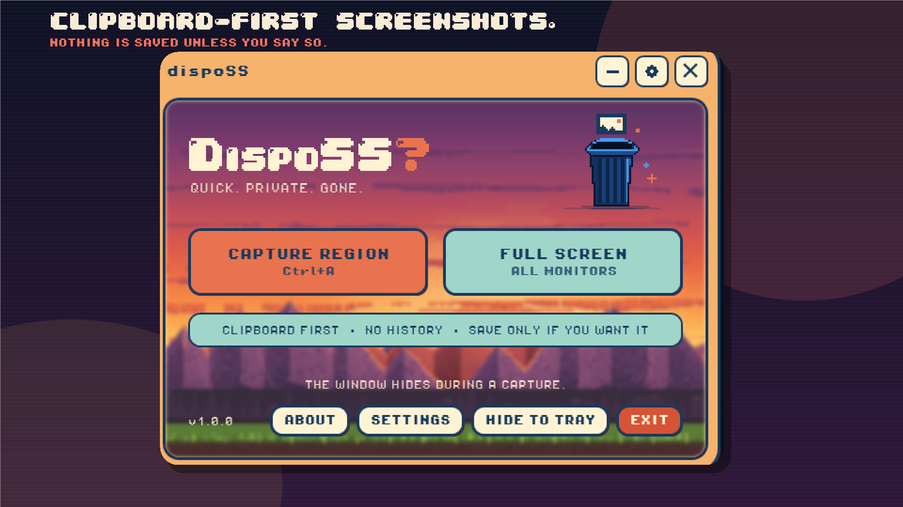
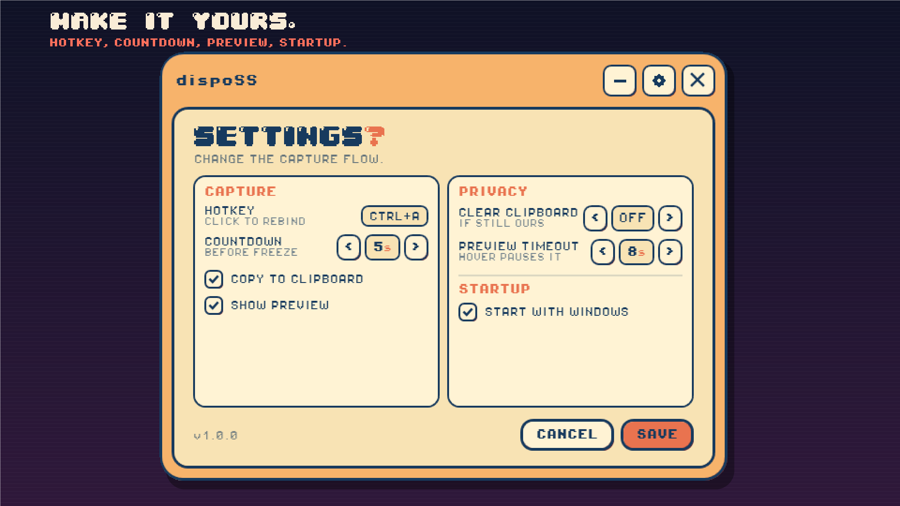
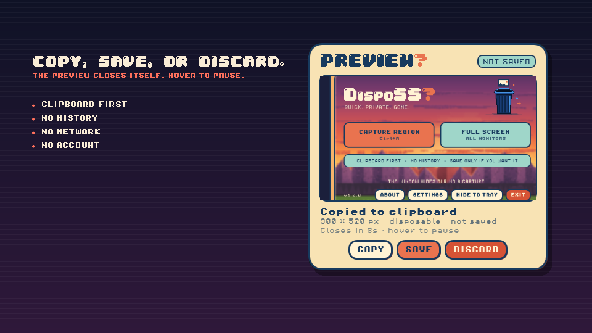
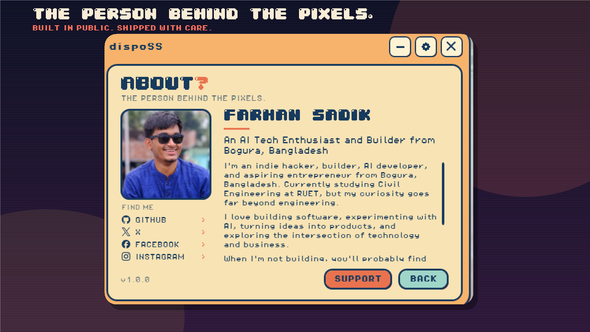

<p align="center">
  
</p>

<h1 align="center">dispoSS</h1>

<p align="center">
  <strong>Clipboard-first screenshots for Windows.</strong><br>
  Quick. Private. Gone.
</p>

<p align="center">
  <a href="https://github.com/farhansadik007/dispoSS/releases/latest">Download for Windows</a>
  ·
  <a href="PRIVACY.md">Privacy</a>
  ·
  <a href="https://www.supportkori.com/farhansadik007">Support the project</a>
</p>

<p align="center">
  <strong>Microsoft Store — coming soon</strong>
</p>

<p align="center">
  
</p>

## The idea

Most screenshot tools want to become a library, a workspace, or a cloud account. dispoSS goes the other way.

Press a hotkey, wait for the countdown, drag a region, and the capture is already on your clipboard. A small preview lets you copy it again, save it, or throw it away. Nothing is written to disk unless you click **Save**.

It is a small native Windows app built with **C# / WPF on .NET Framework 4.8** — no Electron, no bundled browser, no background service, and no networking code.

## Screenshots

| Capture | Settings |
| --- | --- |
|  |  |
| **Preview** | **About** |
|  |  |

## Features

### Capture the way you want

- **Region capture** on the monitor where the selection starts
- **Full-screen capture** across the entire virtual desktop
- Global hotkey configurable as **Ctrl + one non-modifier key** (default `Ctrl+Alt+S`)
- Countdown delay before the screen is frozen
- Capture from the main window, the tray menu, or the hotkey
- `Esc` or right-click cancels selection; pressing the hotkey again also cancels

### Clipboard first, disk second

- Every capture is copied to the clipboard
- Preview actions: **Copy**, **Save**, **Discard**
- Optional preview that closes itself, and pauses while hovered
- Optional clipboard auto-clear that only clears the image if it is still ours
- No screenshot history, no temp capture files, no automatic saves
- Default save name: `dispoSS_YYYY-MM-DD-HH-mm-ss.png`

### Native Windows behavior

- .NET Framework **4.8** WPF app, not a web wrapper
- Per-monitor DPI aware (`PerMonitorV2`)
- Single-instance: launching it again brings back the existing window
- Closing the window hides to the system tray instead of exiting
- Optional **Start with Windows**
- Per-user install, no administrator rights
- GitHub installer is unsigned; the Microsoft Store build will be Microsoft-signed

### Small details

- Sunset retro visual theme with pixel typography
- In-window settings panel with **Save** / **Cancel**
- About panel with photo, bio, and social links
- Body text uses **Pixel Operator 8**; display headings use **04b_30**
- The app is intentionally quiet: no account, no onboarding, no telemetry

## Microsoft Store

The Microsoft Store version is **coming soon**.

dispoSS has been submitted as an x64 full-trust MSIX. Store installs will be signed by Microsoft and will avoid the unsigned-publisher SmartScreen warning from the GitHub installer. The GitHub release remains available as the direct-download channel.

> Store link will be added here after certification.

## Install

### GitHub Releases (available now)

1. Open the [latest release](https://github.com/farhansadik007/dispoSS/releases/latest).
2. Download `dispoSS-Setup.exe`.
3. Run it. The install is per user and does not require administrator rights.

Default install location:

```text
%LOCALAPPDATA%\Programs\dispoSS
```

The installer adds Start Menu and desktop shortcuts. If the app is already running, setup closes it and continues.

### Microsoft Store

Coming soon. Once live, the Store listing will be linked here.

## Verify the download

Each release includes `SHA256SUMS.txt`.

```powershell
Get-FileHash .\dispoSS-Setup.exe -Algorithm SHA256
```

A matching checksum confirms the file matches the published release. It is not a substitute for code signing or SmartScreen reputation.

## Privacy

dispoSS does not contain networking code. Captures stay in memory and, if you choose, on the clipboard or in a file you explicitly save. Settings and a small diagnostic log are stored locally; the log does not contain screenshot pixels or clipboard contents.

Read the full [privacy policy](PRIVACY.md).

## Under the hood

The capture flow is deliberately simple:

1. The countdown runs before touching the screen, so menus and hover states can settle.
2. A GDI snapshot of the virtual desktop is taken once.
3. An opaque, topmost overlay is created per monitor from that frozen snapshot.
4. The selection rectangle is mapped from overlay DIPs back to physical pixels.
5. The frozen image is cropped and optionally copied to the clipboard.
6. The preview holds the image in memory until it closes or you save it.

The app uses `RegisterHotKey` for the global hotkey, a hidden `HwndSource`, WPF for the interface, and the system tray for background access.

<details>
<summary><strong>Build from source</strong></summary>

Requirements:

- Windows 10 (1903+) or Windows 11
- .NET Framework 4.8
- .NET SDK **10.0.402** or newer for development

From the repository root:

```powershell
.\build.cmd      # Debug build
.\dev.cmd        # dotnet watch with hot reload and dev settings
.\publish.cmd    # Framework-dependent release build in dist\win-x64
.\installer.cmd  # Build the Windows installer in dist (requires Inno Setup 6)
.\package.cmd    # Build the x64 Microsoft Store MSIX in dist\store
```

`dotnet watch` hot-reloads C# changes. XAML changes trigger a rebuild and app restart rather than a live visual refresh.

`installer.cmd` requires [Inno Setup 6](https://jrsoftware.org/isinfo.php):

```powershell
winget install JRSoftware.InnoSetup
.\installer.cmd
```

The installer output is `dist\dispoSS-Setup.exe`. The Store package output is `dist\store\dispoSS_1.0.0.0_x64.msix`. See [`store/SUBMISSION.md`](store/SUBMISSION.md) for the Store listing and test-signing workflow.

For smoke testing without a mouse:

```powershell
.\src\DisposableScreenshots\bin\Debug\net48\dispoSS.exe --capture
.\src\DisposableScreenshots\bin\Debug\net48\dispoSS.exe --capture-full
.\src\DisposableScreenshots\bin\Debug\net48\dispoSS.exe --tray
```

</details>

<details>
<summary><strong>Project structure</strong></summary>

| Path | Responsibility |
| --- | --- |
| `src/DisposableScreenshots/App.xaml.cs` | Startup, tray, hotkey, single instance, settings application |
| `Views/MainWindow.xaml.cs` | Capture view, settings transition, window actions |
| `Controls/SettingsPanel.xaml.cs` | In-window settings panel and draft settings |
| `Themes/SunsetTheme.xaml` | Sunset palette, pixel controls, rounded frame, preview/countdown styles |
| `Services/CaptureCoordinator.cs` | Countdown, snapshot, overlays, preview orchestration |
| `Services/ScreenCaptureService.cs` | GDI desktop snapshot and pixel cropping |
| `Services/HotkeyService.cs` | `RegisterHotKey` + hidden `HwndSource` |
| `Services/ClipboardService.cs` | Clipboard image data and conditional auto-clear |
| `Views/PreviewWindow.xaml.cs` | Copy/save/discard toast |

</details>

## Design notes

- The desktop is frozen **after** the countdown; the countdown is not part of the screenshot.
- Region selection is limited to one monitor at a time in this version. Full-screen capture spans all monitors.
- The clipboard auto-clear timer only clears the clipboard if the custom marker data is still present.
- The app targets .NET Framework 4.8 to keep the download small without bundling a runtime.
- The sunset theme is intentional: warm gradients, hard offset shadows, rounded frames, and pixel fonts.

<p align="center">
  
</p>

## About the maker

| | |
| --- | --- |
|  | **Farhan Sadik**<br><br>AI tech enthusiast and builder from Bogura, Bangladesh. Indie hacker, AI developer, and Civil Engineering student at RUET. I like turning small ideas into useful products — and shipping them with a little personality.<br><br>[GitHub](https://github.com/farhansadik007) · [X](https://x.com/SadikZisan) · [Facebook](https://www.facebook.com/FarhanSadikZisan/) · [Instagram](https://www.instagram.com/_sadik.farhan_/) |

If dispoSS is useful to you, you can support the project here:

https://www.supportkori.com/farhansadik007

## Known limitations

- The GitHub installer is unsigned, so SmartScreen may warn on another machine.
- Region selection does not span multiple monitors yet.
- No annotation, scrolling capture, OCR, or screenshot history.
- No automatic updater.
- `dotnet watch` restarts on XAML changes instead of doing true live XAML reload.

## Credits

- **Pixel Operator 8** by Jayvee Enaguas (HarvettFonts), used for body and control text (CC0 1.0, public domain).
- **04b_30** by 04 / Yuji Oshimoto, used for display headings ([DaFont](https://www.dafont.com/04b-30.font)).
- Social icons derived from [Simple Icons](https://simpleicons.org/) (CC0 1.0); brand logos remain trademarks of their owners.

See [THIRD_PARTY_NOTICES.md](THIRD_PARTY_NOTICES.md) for details.

## License

MIT License. See [LICENSE](LICENSE). Third-party components and assets are covered by their own terms.
